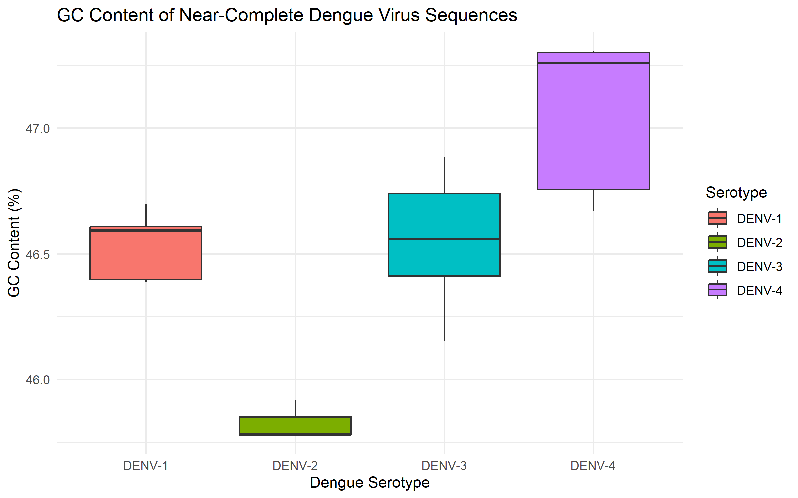

# 2021asp61
# Dengue Virus Sequence Analysis Using R

## 1. Project Overview

This project focuses on analyzing dengue virus
sequences using bioinformatics techniques in R.

The study aims to explore the nucleotide
composition, sequence length, and GC content
of different dengue virus serotypes.

## 2. Research Question

How do nucleotide composition, genome length,
and GC content differ among the four dengue
virus serotypes?

## 3. Objectives

- Obtain dengue virus sequences from public databases.
- Import and preprocess biological sequence data.
- Perform exploratory data analysis.
- Calculate nucleotide composition and GC content.
- Visualize and interpret the results.

## 4. Data Source

NCBI GenBank / NCBI Virus.

## 5. Tools and Technologies

- R Programming
- RStudio
- Biostrings
- ggplot2
- dplyr

## 6. Project Status

Project initialization.

Data collection and analysis are in progress.

## 7. results 
### GC Content Comparison

### Sequence Length Comparison

