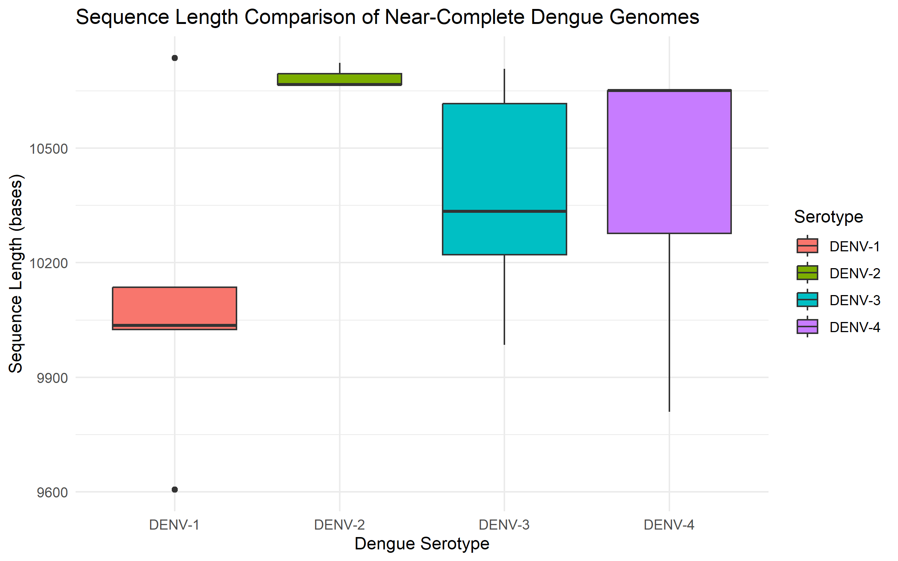

# Dengue Virus Sequence Analysis Using R

**Bioinformatics Project**

**Student:** E.V. Thushara Sandeepani  
**Registration Number:** 2021/ASP/61  
**Department:** Department of Physical Science  
**Faculty:** Faculty of Applied Science  
**University:** University of Vavuniya, Sri Lanka

---

## 1. Abstract

Dengue is a mosquito-borne viral disease caused by the dengue virus (DENV), which has four distinct serotypes: DENV-1, DENV-2, DENV-3, and DENV-4. This project analyses dengue virus nucleotide sequences using the R programming language. The main objective is to compare the four serotypes based on genome length, nucleotide composition, and GC content.

FASTA sequence datasets representing the four dengue serotypes were collected from NCBI GenBank. The sequences were processed and analysed using R and the Biostrings package. Data cleaning was performed to identify sequences containing ambiguous nucleotides. Statistical summaries and visualisations were generated using dplyr and ggplot2.

The analysis identified differences in sequence length and nucleotide composition among the serotypes. The results provide a basic comparative overview of dengue virus sequence characteristics.

## 2. Introduction

Dengue virus is an important mosquito-borne virus that affects people in tropical and subtropical regions. It is mainly transmitted through infected *Aedes* mosquitoes.

Dengue virus has four major serotypes:

- DENV-1
- DENV-2
- DENV-3
- DENV-4

Each serotype contains genetic differences in its nucleotide sequence. Analysing these sequences helps researchers understand the genetic characteristics of the virus.

Bioinformatics combines biology, computer science, and data analysis to study biological information. In this project, bioinformatics techniques are used to analyse dengue virus DNA sequences using R.

### 2.1 Problem Statement

The four dengue virus serotypes may differ in their nucleotide composition, sequence length, and GC content. Therefore, a comparative sequence analysis is useful to identify these differences.

### 2.2 Research Question

How do nucleotide composition, genome length, and GC content differ among the four dengue virus serotypes?

## 3. Objectives

The main objectives of this project are:

1. To collect dengue virus nucleotide sequences for all four serotypes.
2. To calculate the length of each sequence.
3. To analyse nucleotide composition (A, T, G, and C).
4. To calculate the GC content of each sequence.
5. To identify sequences containing ambiguous nucleotides.
6. To clean and filter the sequence dataset.
7. To compare the characteristics of the four serotypes using statistical summaries and graphs.

## 4. Dataset Description

The nucleotide sequences were obtained from the NCBI GenBank database.

Four FASTA files were used in this analysis:

| File | Serotype |
|---|---|
| DENV1.fasta | DENV-1 |
| DENV2.fasta | DENV-2 |
| DENV3.fasta | DENV-3 |
| DENV4.fasta | DENV-4 |

### 4.1 FASTA Format

FASTA is a text-based format used to store biological sequences.

Each FASTA record contains:
- A header line beginning with `>`.
- A nucleotide sequence containing bases such as A, T, G, and C.

### 4.2 Nucleotide Information

| Nucleotide | Meaning |
|---|---|
| A | Adenine |
| T | Thymine |
| G | Guanine |
| C | Cytosine |
| N | Unknown or ambiguous nucleotide |

## 5. Tools and Technologies

The following tools and R packages were used:

| Tool / Package | Purpose |
|---|---|
| R | Data analysis and calculations |
| RStudio | R development environment |
| Biostrings | Biological sequence processing |
| dplyr | Data manipulation and summarisation |
| ggplot2 | Data visualisation |
| knitr | Generating the HTML report |
| Git and GitHub | Version control and project sharing |

## 6. Methodology

The project followed a sequence analysis workflow consisting of data collection, preprocessing, sequence analysis, data cleaning, statistical summarisation, and visualisation.

### 6.1 Data Collection

Four FASTA files representing DENV-1, DENV-2, DENV-3, and DENV-4 were collected from NCBI GenBank.

### 6.2 Sequence Import

The Biostrings package was used to import the FASTA files into R.

The `readDNAStringSet()` function was used to read the nucleotide sequences.

### 6.3 Sequence Length Calculation

The length of each nucleotide sequence was calculated using the `width()` function.

This helped identify differences in sequence lengths among the four serotypes.

### 6.4 Nucleotide Composition Analysis

The number of adenine (A), thymine (T), guanine (G), and cytosine (C) nucleotides was calculated using the `letterFrequency()` function.

The nucleotide percentages were calculated based on the valid A, T, G, and C bases.

### 6.5 GC Content Calculation

GC content represents the percentage of guanine (G) and cytosine (C) nucleotides in a sequence.

The formula used was:

**GC Content (%) = ((G + C) / (A + T + G + C)) × 100**

### 6.6 Data Quality Assessment

The nucleotide `N` represents an unknown or ambiguous base.

The percentage of ambiguous nucleotides was calculated for each sequence.

Sequences containing more than 5% ambiguous nucleotides were excluded from the cleaned dataset.

### 6.7 Near-Complete Sequence Selection

After data cleaning, sequences with a length of at least 9,000 nucleotides were selected for a separate near-complete sequence comparison.

This threshold was used as an operational filtering criterion for this analysis.

### 6.8 Statistical Analysis

The dplyr package was used to group sequences by serotype and calculate:

- Number of sequences
- Minimum and maximum sequence length
- Mean sequence length
- Mean GC content
- Mean nucleotide percentages

### 6.9 Data Visualisation

The ggplot2 package was used to create graphs for comparing:

- GC content
- Sequence length

The graphs were saved in the `results/figures/` directory.

## 7. Results

### 7.1 Data Cleaning Results

After removing sequences containing more than 5% ambiguous nucleotides, 39 sequences remained.

| Serotype | Number of Cleaned Sequences |
|---|---:|
| DENV-1 | 8 |
| DENV-2 | 10 |
| DENV-3 | 11 |
| DENV-4 | 10 |
| **Total** | **39** |

### 7.2 Near-Complete Sequence Analysis

A total of 23 sequences with lengths of at least 9,000 nucleotides were selected for the near-complete sequence comparison.

| Serotype | Number of Sequences | Mean Length | Mean GC (%) |
|---|---:|---:|---:|
| DENV-1 | 5 | 10,108 | 46.5 |
| DENV-2 | 3 | 10,685 | 45.8 |
| DENV-3 | 10 | 10,382 | 46.6 |
| DENV-4 | 5 | 10,408 | 47.1 |

### 7.3 Main Findings

- DENV-4 showed the highest mean GC content (47.1%).
- DENV-2 showed the lowest mean GC content (45.8%).
- DENV-2 had the highest mean sequence length (10,685 nucleotides) in the near-complete dataset.
- The four serotypes showed differences in nucleotide composition and sequence length.

### 7.4 Generated Figures

The following figures were generated:

- `gc_content.png`
- `sequence_length.png`
- `near_complete_gc_content.png`
- `near_complete_sequence_length.png`

These figures are available in `results/figures/`.

## 8. Discussion

The analysis shows that the four dengue virus serotypes have differences in their nucleotide composition, GC content, and sequence length.

Among the near-complete sequences, DENV-4 had the highest average GC content, while DENV-2 had the lowest. DENV-2 also showed the highest mean sequence length in this selected dataset.

Data cleaning was an important step because some sequences contained ambiguous nucleotides. Removing sequences with more than 5% ambiguous bases helped improve the quality of the dataset used for comparison.

However, the number of sequences was not equal across all four serotypes. Therefore, the results should be interpreted as descriptive findings from the available dataset, not as proof of statistically significant differences.

## 9. Conclusion

This project successfully performed a basic comparative analysis of four dengue virus serotypes using R.

The analysis included sequence length calculation, nucleotide composition analysis, GC content calculation, data cleaning, statistical summarisation, and visualisation.

The results showed differences among DENV-1, DENV-2, DENV-3, and DENV-4 in their sequence characteristics.

This project demonstrates how bioinformatics tools and R programming can be used to analyse biological sequence data.

## 10. Limitations and Future Work

### Limitations

- The analysis used a limited number of available sequences.
- The number of sequences differed among the four serotypes.
- Some sequences contained ambiguous nucleotides.
- The analysis focused on descriptive statistics.
- Statistical significance testing and mutation detection were not performed.

### Future Work

Future improvements may include:

- Using a larger sequence dataset.
- Performing multiple sequence alignment.
- Identifying mutations and conserved regions.
- Applying statistical tests to compare serotypes.
- Using machine learning methods for sequence classification.

## 11. Project Structure

```text
2021asp61/
│
├── data/
│   ├── DENV1.fasta
│   ├── DENV2.fasta
│   ├── DENV3.fasta
│   └── DENV4.fasta
│
├── code/
│   ├── analysis.R
│   ├── Dengue_Analysis.Rmd
│   └── Dengue_Analysis.html
│
├── results/
│   ├── sequence_results.csv
│   ├── composition_summary.csv
│   ├── cleaned_sequence_results.csv
│   ├── near_complete_sequences.csv
│   ├── near_complete_summary.csv
│   │
│   └── figures/
│       ├── gc_content.png
│       ├── sequence_length.png
│       ├── near_complete_gc_content.png
│       └── near_complete_sequence_length.png
│
├── README.md
├── .gitignore
└── 2021asp61.Rproj
```

## 12. Reproducibility

To reproduce this analysis:

1. Clone or download the GitHub repository.
2. Open the `2021asp61.Rproj` file using RStudio.
3. Make sure the required R packages are installed.
4. Open `code/Dengue_Analysis.Rmd`.
5. Click the **Knit** button to generate the HTML report.

Required packages:

```r
install.packages(c("dplyr", "ggplot2", "knitr"))
if (!requireNamespace("BiocManager", quietly = TRUE))
    install.packages("BiocManager")
BiocManager::install("Biostrings")
```


## 7. results 
### GC Content Comparison


### Sequence Length Comparison

